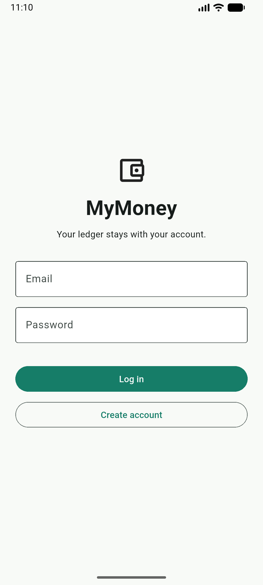
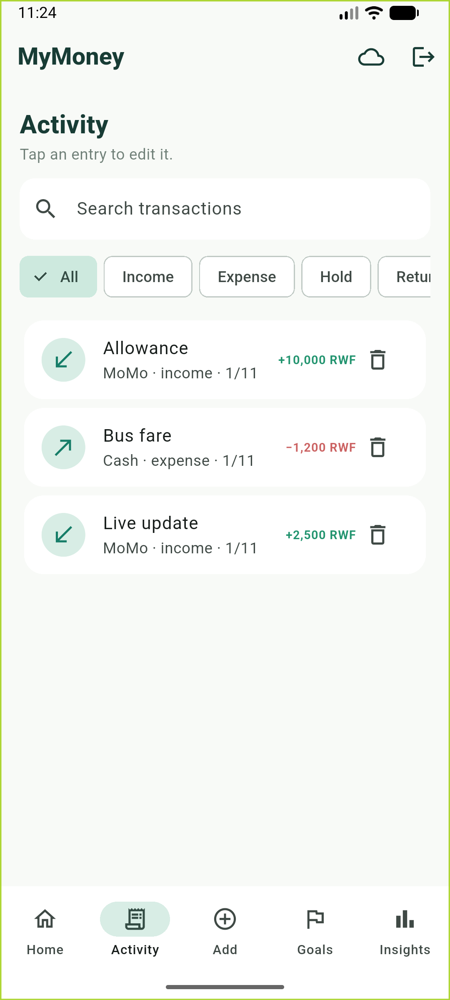
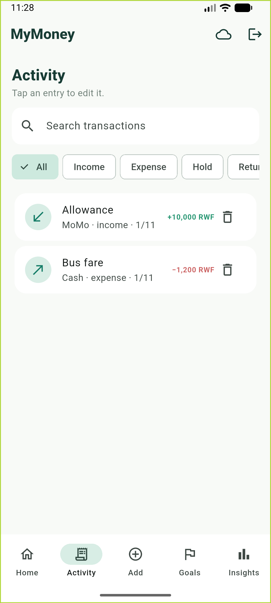
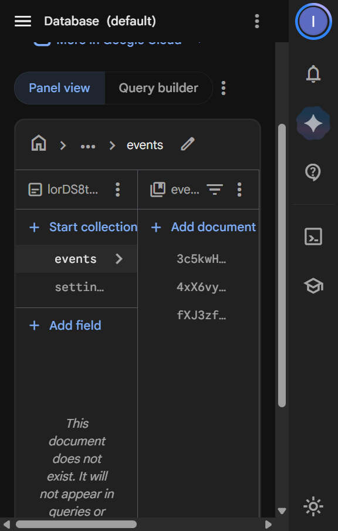

<p align="center">
  
</p>

MyMoney is a personal ledger for income, spending, money held for someone else, savings goals, and budgets. Sign-in is Firebase email and password. Each person's records live in Cloud Firestore under their own id, so two accounts never see each other's data, and every change shows up while the app is open.

## Try it

Use these accounts on the Android app. The password is the same for both.

| Account | Email | Password | What you should see |
| --- | --- | --- | --- |
| First | `mymoney.demo1@gmail.com` | `Money123` | Allowance, bus fare, and a **Live update** of +2,500 RWF |
| Second | `mymoney.demo2@gmail.com` | `Money123` | Its own allowance and bus fare. No Live update |

A brand-new account gets sample opening balances (Cash 18,000, MoMo 57,000, Bank 110,000), one bus fare, and one allowance.

## Run it

From the project folder:

```powershell
cd C:\Users\hp\Downloads\mymoney
flutter run -d emulator-5554
```

The Android emulator must already be on. If Flutter asks you to pick a device, choose the emulator, not Chrome. Chrome is only a preview: it skips Firebase and keeps an in-memory ledger, so login and live cloud data are not there.

If the build says `google-services.json` is missing, the file belongs in `android\app\`, next to `build.gradle.kts`. The Android package name is `com.example.mymoney`.

## Walk through the screens

1. **Log in** with the first account, or tap **Create account** with a new email and a password of at least 6 characters.
2. **Home** shows money you can spend, the three accounts, and the latest activity. The cloud button loads Kigali weather. The door icon logs out.
3. **Activity** lists every transaction. Tap a row to edit it. The trash icon asks you to confirm, then deletes it. A change that would make a balance or held-money history invalid is refused, and nothing is saved.
4. **Add** records income, an expense, money held for someone, or a return. Amounts must be whole numbers greater than zero.
5. **Goals** is where you add a savings goal and put money toward it.
6. **Insights** shows spending against the category budgets, by day, week, or month.

Then log out and sign in as `mymoney.demo2@gmail.com`. That account has its own sample rows. The Live update from the first account is not there. Log back into the first account and the Live update is still there.

## Screenshots

<p align="center">
  
  
  
</p>

<p align="center">
  
</p>

| File | What it shows |
| --- | --- |
| `screenshots/login.png` | The login screen |
| `screenshots/console.png` | Firestore, open on that user's `events` |
| `screenshots/live.png` | The Live update row, after it was added in the console while the app stayed open |
| `screenshots/denied.png` | The second account, with its own sample data only |

## What it keeps

| Path | Contents |
| --- | --- |
| `users/{uid}/events` | kind, account, amount, category, person, note, date |
| `users/{uid}/goals` | name, target, saved |
| `users/{uid}/settings/ledger` | opening balances and category budgets |

Balances, available money, held totals, and insights are calculated from those documents. They are not stored.

Firestore rules allow a signed-in user to read and write only `users/{their own id}/`. Anyone else, including a signed-out visitor, is refused.
