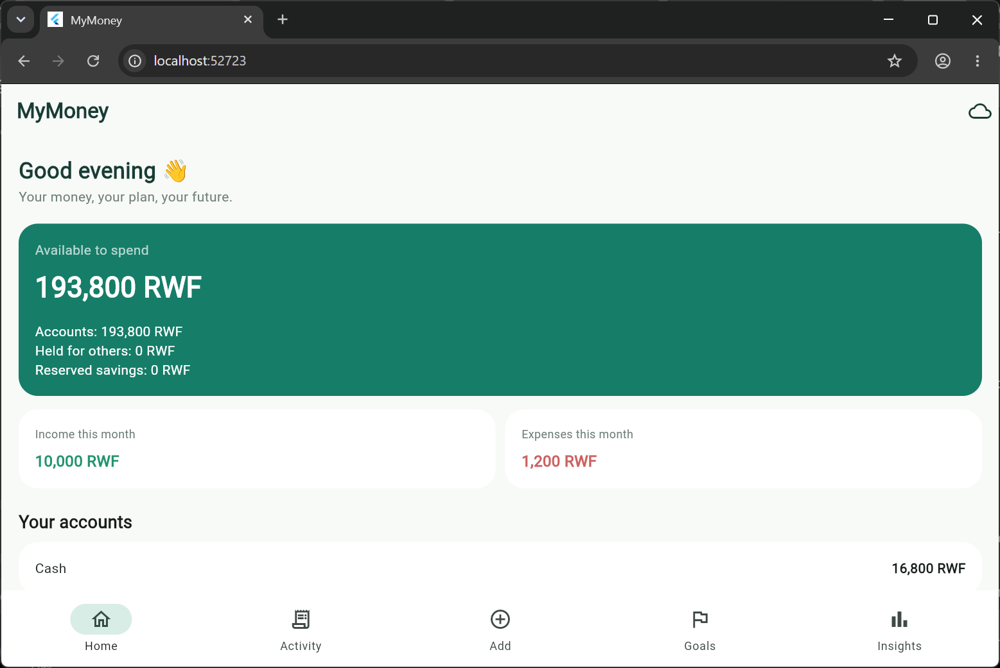
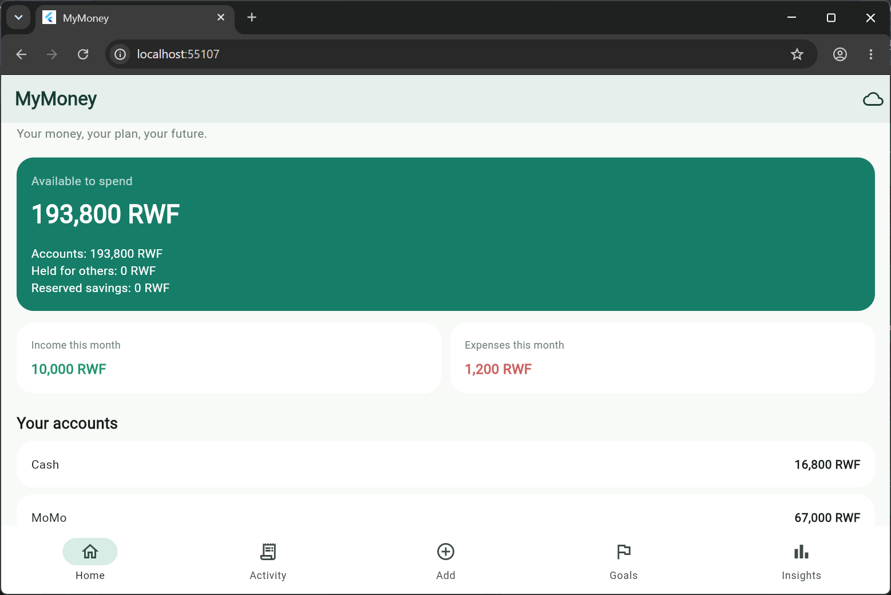
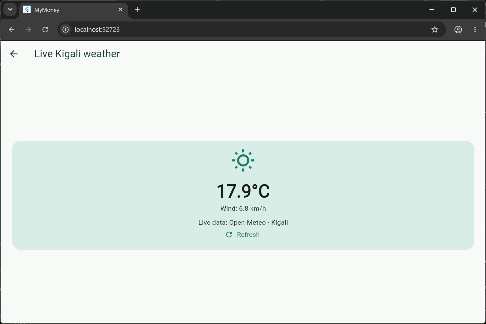
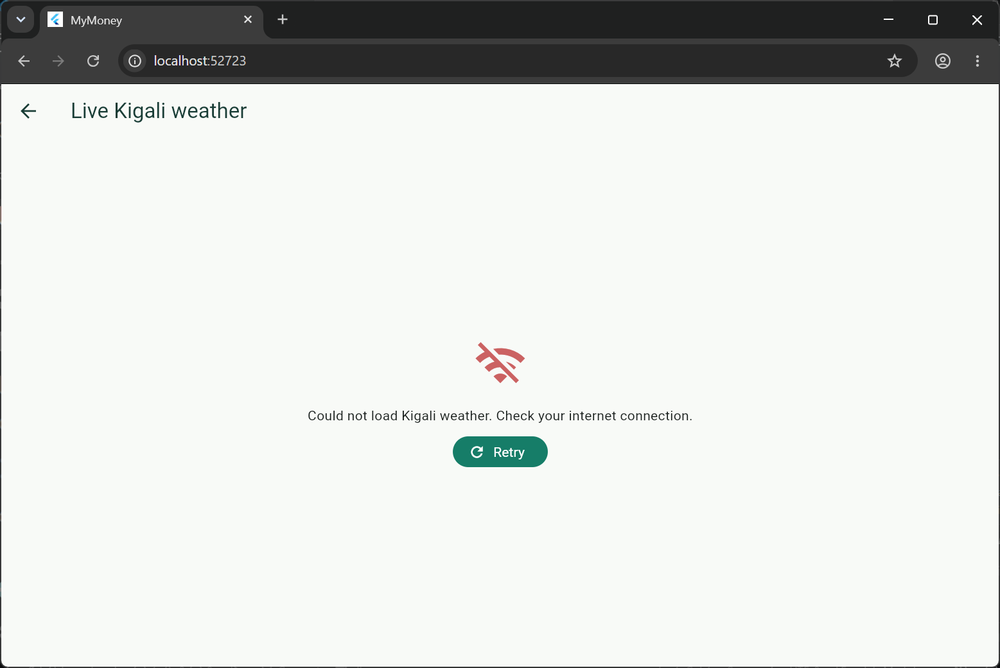

<div align="center">

# ✳ MyMoney

### A tiny ledger for a bigger life.

**Earn it. Spend it. Keep it straight.**

  

</div>

---

> **The thought behind it**  
> Some money is yours. Some is passing through your hands. Some you've promised to your future self. **MyMoney knows the difference.**

An Emerald & Cream Flutter money diary for recording income, everyday spending, money held for someone else, savings goals and category budgets. It started as five simple Dart commands in **Lab 12**, became a five-tab app for the **mini-project**, and gained local persistence and a real weather API for **Session 5**.

### THE FIVE ROOMS

| 01 · Home | 02 · Activity | 03 · Add | 04 · Goals | 05 · Insights |
|---|---|---|---|---|
| See what you can really spend | Search and filter history | Record four kinds of movement | Set budgets and reserve savings | Day / week / month totals |

**The palette:** `#167D68` emerald · `#F8FAF7` cream · `#D9A65B` gold · `#D8EDE5` sage · `#183C35` forest ink.

---

## 01 — The brain, before the body (Lab 12)

**The problem:** A person can have money in several places, spend some today, and keep some for someone else. Simply adding everything together tells the wrong financial story.

**The commands** (our original Lab 12 design):

| Command | Changes |
|---|---|
| `income:account:amount` | Own money deposited into an account |
| `expense:account:category:amount` | Own money spent on a category |
| `hold:account:person:amount` | Money received, but owed to someone else |
| `return:account:person:amount` | Return part or all of that person's money |
| `summary` | Prints account balances without changing state |

Data at rest: `MoneyLedger` keeps Maps for account opening balances and budgets, a List of transaction `MoneyEvent`s, and a List of `SavingsGoal`s. `handle()` in `lib/services/lab12.dart` splits each command on `:`, routes with conditional branches, validates and calls the ledger, then returns one output line for *every* command. Unknown commands never crash the app.

**Ten actions. One story.** The scenario begins with a 50,000 RWF MoMo deposit, includes groceries and transport, holds Eric's funds, refuses overspending and over-returning, and ends with a summary and an unknown command.

```text
income:momo:50000
expense:momo:food:3500
income:cash:10000
hold:bank:Eric:20000
expense:cash:transport:1200
return:bank:Eric:5000
expense:cash:snacks:20000
return:bank:Eric:30000
summary
fly:momo:1000
```

**Expected output — recorded in source before execution:**

```text
Received 50000 RWF in MoMo
Spent 3500 RWF on food from MoMo
Received 10000 RWF in Cash
Holding 20000 RWF for Eric in Bank
Spent 1200 RWF on transport from Cash
Returned 5000 RWF to Eric from Bank
Refused: Insufficient personal balance in Cash
Refused: Cannot return more than owed to Eric in Bank
Summary: Cash 8800, MoMo 46500, Bank 15000 RWF
Unknown command: fly:momo:1000
```

**The ending:** Cash 8,800 + MoMo 46,500 + Bank 15,000 = **70,300 RWF in accounts**, of which **15,000 RWF belongs to Eric**; your available amount is **55,300 RWF**.

To replay the command stream:

```bash
dart run lib/lab12_runner.dart
```

**Lab 12 Think — which lab patterns were reused?** Lab 2 appears in `split(':')`, `int.tryParse` and validation at the gate. Labs 10–11 appear in how each command changes shared state, and later commands observe the updated balances. Lab 3 appears in summing transaction amounts, while Lab 7's condition-building approach is used for insufficient-funds and over-return rules.

---

## 02 — When buttons replaced commands (Mini Project)

| Lab 12 text | Flutter interaction |
|---|---|
| `income` | Add → Income |
| `expense` | Add → Expense + category |
| `hold` | Add → Hold + owner name |
| `return` | Add → Return + owner name |
| `summary` | Home account balances + available money |

Additional mini-project features: multiple screens, model classes, empty states, sample opening balances, independent validation rules in `MoneyLedger`, immediate UI updates, transaction search and filter, deletion with confirmation, savings goal progress bars, and editable monthly budgets.

**The rules are more important than the colors:**

- Held money increases the account balance, **not personal income or available money**.
- You cannot spend funds owed to someone else.
- A return cannot exceed what that person is owed **in the selected account**.
- A transaction cannot be deleted when removing it would make the historical balance or held-money obligations invalid.
- Savings allocations reserve your own money; they are not expenses.
- All amounts are positive whole-number RWF, not floating-point balances.
- Sample *opening* balances are not counted as income. You may replace them when you initialize a new ledger.

**Mini-project Think 1 — hardest command to turn into a screen:** `return`, because the UI has to collect the owner, account and amount, then show a meaningful rejection if that exact account does not contain enough of the owner's funds.

**Mini-project Think 2 — what changed after adding a screen:** Text command parsing was replaced with form controls, and every action now displays feedback. The ledger rules stayed separate from the UI so both the command scenario and the Flutter interface use the same logic.

---

## 03 — It remembers (Session 5)

The entire ledger is serialized to JSON and stored using **`shared_preferences`**. Each successful change writes the latest account, event, goal and budget data locally, and startup restores it. It is a small learning project, not a secure banking application, and does not connect to any real financial accounts.

Tap the **cloud icon** in the app bar to open **Live Kigali weather**, fetched from [Open-Meteo](https://open-meteo.com/) with an HTTP GET request. There are three visible network states:

`Loading…` → `Live temperature + wind` **or** `No connection / service error + Retry`.

The weather is educational and intentionally separate from money calculations.

---

## 04 — Exhibit wall: the four required screenshots

These are to be captured from the **real running application** and placed in `screenshots/`. They are intentionally not manufactured in this source package.

| Before close | After reopening |
|---|---|
|  |  |

| Live API | Offline + Retry |
|---|---|
|  |  |

**How to capture them:** record a few entries → screenshot `before.png` → stop and rerun Flutter → `after.png` → open cloud icon while online → `api.png` → switch off network and retry → `no-internet.png`. Filenames are case-sensitive. See `screenshots/README.md`.

---

## 05 — Run it yourself

**Requirements:** Flutter SDK, Dart SDK, VS Code or Android Studio, plus Chrome or an Android emulator.

```bash
# Run inside the extracted mymoney folder
flutter create .
flutter pub get
flutter analyze
flutter test
flutter run -d chrome
```

`flutter create .` creates platform folders if they aren't included in this portable source archive. To test persistence, fully stop the app and run it again; **hot restart is not a substitute for a full close/reopen test**.

**A useful test path:** Add → Income (Cash, 50,000) → Expense (Food, 3,500) → Hold (Eric, 20,000) → Return (Eric, 5,000) → Home/Activity. For the *exact* Lab 12 output use the command runner, which starts with zero opening balances. UI data begins with demonstration account openings.

### Under the hood

```text
lib/
├── main.dart               # 5 screens, UI state, persistent save/load, API screen
├── models/ledger.dart      # Models, balances, obligations, goals and rules
├── services/lab12.dart     # Exactly 5 commands + expected scenario
├── services/weather.dart   # Open-Meteo HTTP client
└── lab12_runner.dart       # Run Lab 12 without Flutter

test/ledger_test.dart       # Scenario + balance/ownership/deletion/JSON tests
screenshots/                # Real submission screenshots (capture on device)
```

### Verification and limitations

- `test/ledger_test.dart` contains assertions for the Lab 12 output, held money, goals and JSON restoration, and deletion safety.
- Flutter must be installed locally to run `flutter analyze`, `flutter test`, and inspect the app. The source archive itself is **not proof of a successful compilation**.
- This version records the current date for UI entries; it doesn't support backdated daily-review entry yet.
- Savings reservations are tracked across the ledger, not assigned to individual bank accounts. For a production finance system, use an actual database and stronger audit/backup rules.

---

## 06 — Submission checklist

- [ ] `flutter analyze` completes successfully on your machine
- [ ] `flutter test` passes on your machine
- [ ] Run Lab 12 scenario and check the ten output lines
- [ ] Add real screenshots: `before.png`, `after.png`, `api.png`, `no-internet.png`
- [ ] Push the complete project to a **public** GitHub repository
- [ ] Check the four screenshot links render in GitHub README
- [ ] Submit the **one repository URL** using your group's submission form

**A project about money should be accountable.** The files show how it works; the screenshots show that it runs; and the student can explain each line.

<div align="center">

---

**MYMONEY / VOL. 01**  
*Small entries. Clearer days. Better decisions.*

✳ `#167D68` · `#F8FAF7` · `#D9A65B`

</div>
